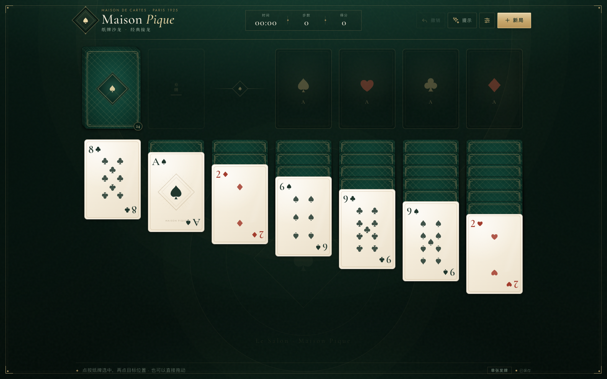
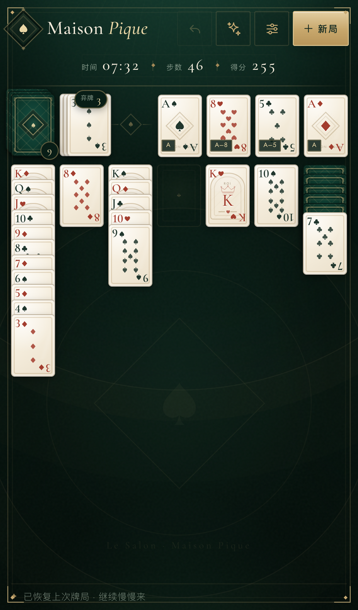
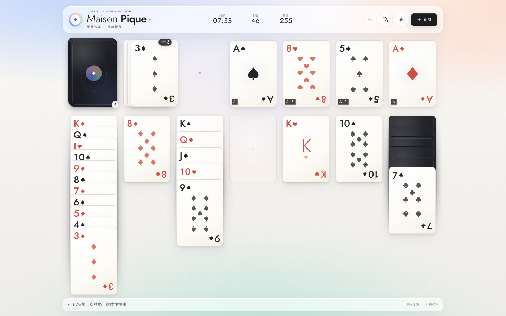
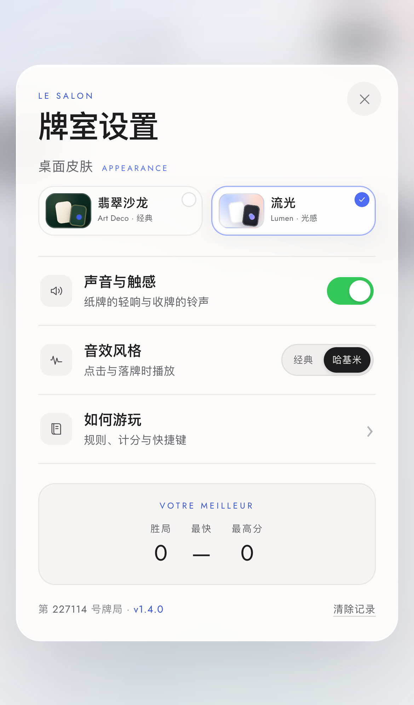
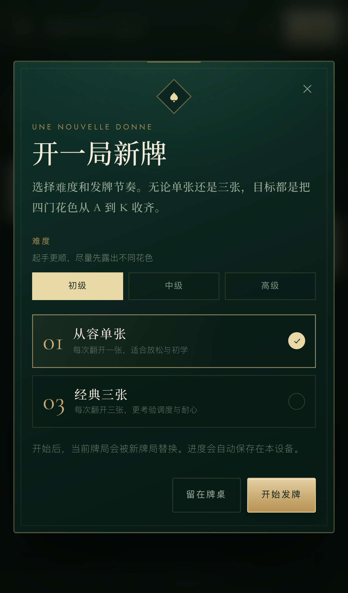

# Maison Pique · 纸牌沙龙

一款无框架依赖的经典克朗代克纸牌接龙（Klondike Solitaire），为手机、平板和桌面浏览器设计。

**在线游玩**：<https://MICEKING2007.github.io/maison-pique-solitaire/>  
**GitHub 仓库**：<https://github.com/MICEKING2007/maison-pique-solitaire>




## 两套皮肤

牌桌提供两套完整皮肤，随时可以在 **设置 → 桌面皮肤** 中切换，选择会保存在本机：

- **翡翠沙龙**：默认的深绿与金色装饰艺术风格。
- **流光 / Lumen**：暖白玻璃、光谱高光与极简牌面，参考 Apple Intelligence 的轻盈光感。




## 难度等级

开新局时可选择 **初级 / 中级 / 高级**：

- **初级**：起手尽量凑齐四种不同花色，并保证至少两步可直接移动。
- **中级**：保证至少花色不单一、至少一步可走，但保留随机性。
- **高级**：减少顺手牌，通常只有一步可走且不直接露出 A。

难度会随牌局保存，菜单底部显示当前难度与发牌模式。后续会继续调整初级的容错与高级的挑战曲线。



## 两套音效

- **经典**：现有的合成纸牌声，轻而克制。
- **哈基米**：从你提供的**第二段视频**音轨里选出 **5 段完整短语**（约 1.5–2.4 秒），不再使用猫哈气噪声，也不再切成一瞬间的碎片。点击和落牌共享一个随机池，5 段全部轮完才重新洗牌，避免一直重复同一句。

切换方式：**设置 → 音效风格**。选中“哈基米”会立刻试听一句；关闭“声音与触感”后全部静音。点击时如果上一句还没说完，会让它继续说完；落牌时可以打断上一句并播放新一句。采样细节见 [`audio/README.md`](audio/README.md)。

## 开始游玩

直接访问 **<https://MICEKING2007.github.io/maison-pique-solitaire/>**，无需安装。

也可以克隆后在本地运行：

```bash
git clone https://github.com/MICEKING2007/maison-pique-solitaire.git
cd maison-pique-solitaire
python3 -m http.server 8123
```

然后打开 <http://127.0.0.1:8123/>。macOS 也可以双击 `start-game.command` 启动。

## 功能

- 经典克朗代克规则：七列接龙、四座基础牌堆、牌堆循环与自动翻牌
- 单张 / 三张两种发牌节奏
- 两套可切换皮肤：翡翠沙龙 / 流光（Lumen），选择会自动保存
- 两套音效风格：经典合成音 / 哈基米视频采样；5 段完整短语随机轮播，避免连续重复
- 三档难度：初级起手更顺、尽量露出不同花色；中级保留挑战；高级少一些顺手牌
- 触屏点选移动、拖拽移动、双击快速归位；支持多张连续牌整组移动
- 不需要先点提示：拖动时所有有效落点会高亮，靠近即磁吸，松手落牌
- 撤销、智能提示（自动选中牌并标出落点，不再来回无效搬牌）
- 计时、步数、计分与本地最佳纪录
- 基础牌堆左下角显示 `A–X` 收牌进度，弃牌堆显示总张数，随时确认某张牌在哪里
- 自动保存当前牌局，刷新或下次打开可继续
- 所有牌面翻开且剩余牌能一路收完时，自动播放收牌动画并收官；也可手动点击“自动收牌”
- 响应式布局，适配手机竖屏 / 横屏、平板与桌面
- 可安装为 PWA（在支持的浏览器和 HTTPS/localhost 环境下），支持离线游玩
- 合成音 / 视频采样音效与触感反馈，可随时关闭
- 完整键盘快捷键、可见焦点与屏幕阅读器标签；已通过 axe WCAG 自动审计

## 操作

| 操作 | 方式 |
| --- | --- |
| 发牌 | 点击左上角牌堆；按 `Space` |
| 移动牌 | 直接拖动；或点按纸牌，再点发光的落点 |
| 快速归位 | 双击纸牌 |
| 撤销 | 顶部“撤销”按钮；按 `U` 或 `⌘Z` |
| 提示 | 顶部“提示”按钮；按 `H`（会自动选中建议的牌） |
| 新局 | 顶部“新局”；按 `N` |
| 切换皮肤 / 音效 | 右上角设置 → 桌面皮肤 / 音效风格 |
| 取消选择 | 按 `Esc` |

## 开发与测试

当前版本：**v1.5.0**。纯 HTML / CSS / ES Modules，无需构建。

```bash
node --test tests/*.test.js
```

规则引擎位于 `js/engine.js`，界面与交互位于 `js/app.js`。字体使用本地自托管 woff2，许可信息见 `fonts/LICENSES.md`。

## 部署

GitHub Pages 直接从 `main` 分支根目录发布，无需构建步骤。页面、字体和 PWA 缓存全部使用相对路径。

发布新版本时，同时更新 `index.html` 与 `js/app.js` 里的 `?v=` 查询串、`sw.js` 的 `CACHE_NAME` 和预缓存地址，确保用户不会停留在旧缓存。当前界面版本号显示在菜单底部（`v1.5.0`）。

## 目录

```
index.html              页面结构
styles.css              视觉系统与响应式基础
lumen.css               流光皮肤样式层
js/engine.js            可独立测试的牌局规则引擎
js/app.js               界面、拖拽、存档、音效、皮肤切换与动效
audio/hakimi/        哈基米完整短语采样（MP3）
manifest.webmanifest    默认 PWA 清单
manifest-lumen.webmanifest 流光 PWA 清单（浅色主题）
sw.js                   离线缓存 Service Worker
assets/                 图标与 PWA 视觉资源
fonts/                  本地字体文件与许可
screenshots/            桌面、手机与胜利界面截图
tests/                  规则引擎单元测试
```
